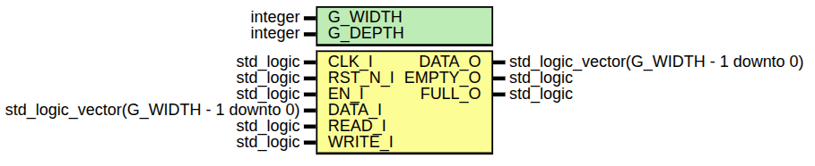
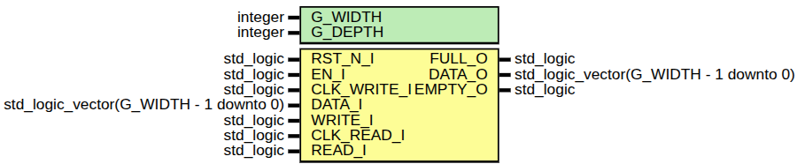
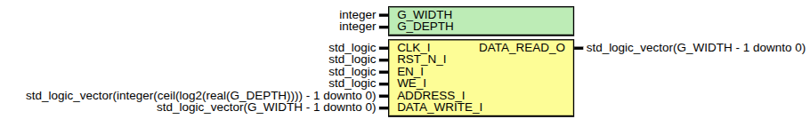
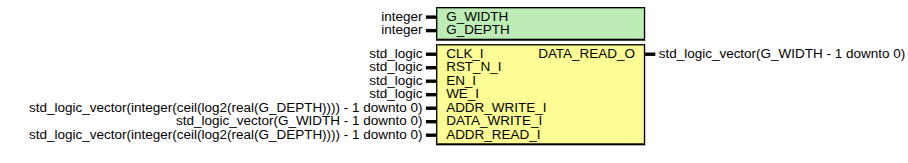
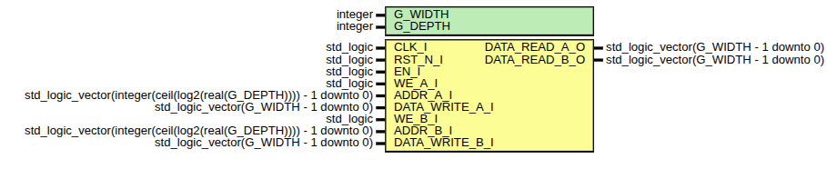
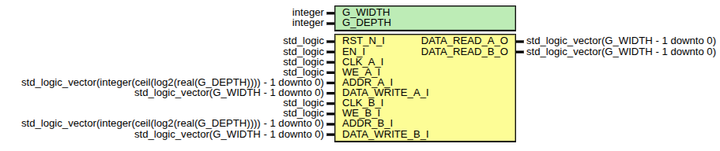

# VHDL_memory
This repo contains all types of memories for VHDL

## FIFO
### SYNC

### ASYNC

## RAM
### SPRAM (Simple Port RAM)

### SDPRAM (Simple Dual Port RAM)
This module has 1 clock.

### DPRAM (Dual Port RAM)
This module has 1 clock.

### TDPRAM (True Dual Port RAM)
This module has 2 different clocks.
